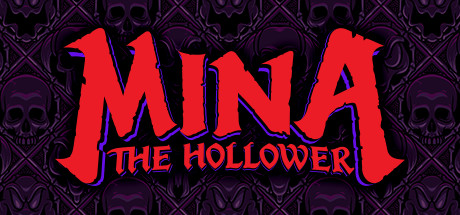

**Mina the Hollower by Yacht Club Games (2025) is a top-down action game clearly inspired by classic Castlevania and Zelda.**

---

## 📖 About

Mina the Hollower by Yacht Club Games (2025) is a top-down action game clearly inspired by classic Castlevania and Zelda. You play as Mina, an inventor on a cursed island, whipping and gadgeting through gothic environments. From the Shovel Knight developer, expect high production quality and brutal optional challenge.

## ⚠️ Problems Without Trainer

| Problem | Status |
|---------|--------|
| Optional cursed gauntlet challenges require near-perfect execution of all abilities | ✅ Solved |
| Gold costs for gadget upgrades exceed standard exploration income mid-game | ✅ Solved |
| Boss patterns on Nightmare difficulty add attacks not present in Normal mode | ✅ Solved |
| Secret key item discoveries locked behind environmental puzzles with zero hints | ✅ Solved |
| Whip charge attacks require input timing that feels inconsistent on controller | ✅ Solved |

## ✅ Solution

The **Mina the Hollower Trainer** solves all these issues, giving you complete control so you can focus on enjoying the game.

## 🎯 Features

- Unlimited Resources / Currency
- God Mode / Invincibility
- Instant Skill & Ability Cooldown
- One-Hit Kill
- Freeze Timers
- Unlock All Items & Achievements
- Custom Speed Multiplier
- Infinite Stamina / Energy

## 🚀 Quick Start

1. **Disable Windows Defender** temporarily (trainer may trigger false positive)
2. Get the trainer from the button above
3. Launch Mina the Hollower
4. Run the trainer as Administrator
5. Use the hotkeys to activate cheats in-game

## 💎 Free vs Pro

| Feature | Free | Pro |
|---------|------|-----|
| God Mode | ✅ | ✅ |
| Unlimited Resources | ✅ | ✅ |
| Advanced Cheats | ❌ | ✅ |
| Auto-Updates | ❌ | ✅ |
| Priority Support | ❌ | ✅ |

## 💻 Requirements

- Windows 10 / 11 (64-bit)
- Mina the Hollower (any version)
- .NET Framework 4.8+
- DirectX 11+

## 🍎 macOS

## ⚖️ Legal

Educational and single-player use only.

---

